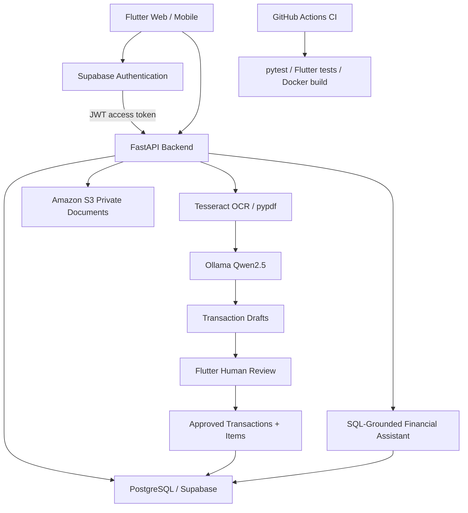

# SpendWise AI — System Architecture

SpendWise AI is a full-stack AI-powered financial
document intelligence application.

## Architecture Diagram

## Technology Stack

| Component | Technology |
|---|---|
| Frontend | Flutter / Dart |
| Backend | Python / FastAPI |
| Authentication | Supabase Auth |
| Database | PostgreSQL / SQLAlchemy |
| Document Storage | Amazon S3 |
| OCR | Tesseract / pypdf |
| AI | Ollama / Qwen2.5 |
| Containerization | Docker |
| CI/CD | GitHub Actions |

## Document Processing Workflow

1. User signs in through Supabase Auth.
2. Flutter sends the access token to FastAPI.
3. User uploads a receipt or PDF.
4. FastAPI validates and stores the document.
5. Tesseract or pypdf extracts text.
6. Ollama produces structured financial data.
7. FastAPI stores pending transaction drafts.
8. User reviews and corrects extracted information.
9. FastAPI saves approved transactions and items in PostgreSQL.

## AI Financial Assistant

The financial assistant interprets user questions
using an LLM-based intent planner.

FastAPI executes predefined SQLAlchemy queries
to calculate financial results.

The LLM cannot execute arbitrary SQL queries.

## Security

- JWT authentication via Supabase Auth
- User-scoped authorization in FastAPI
- Private AWS S3 document storage
- Human review before transaction approval
- Database credentials kept outside source code
- IAM permissions restricted to required AWS resources

## Deployment

The backend is containerized using Docker.

Current local development:
- Flutter runs on Windows / Chrome.
- FastAPI and Tesseract run in Docker.
- Ollama runs locally on Windows.
- PostgreSQL is hosted by Supabase.
- Documents are stored in private AWS S3.

AWS ECS deployment is being prepared, but
cloud-hosted LLM inference is not yet configured.

## Automated Testing

GitHub Actions automatically runs:
- Python backend tests
- Flutter tests and static analysis
- Tracked secret-file checks
- Docker build and smoke tests
